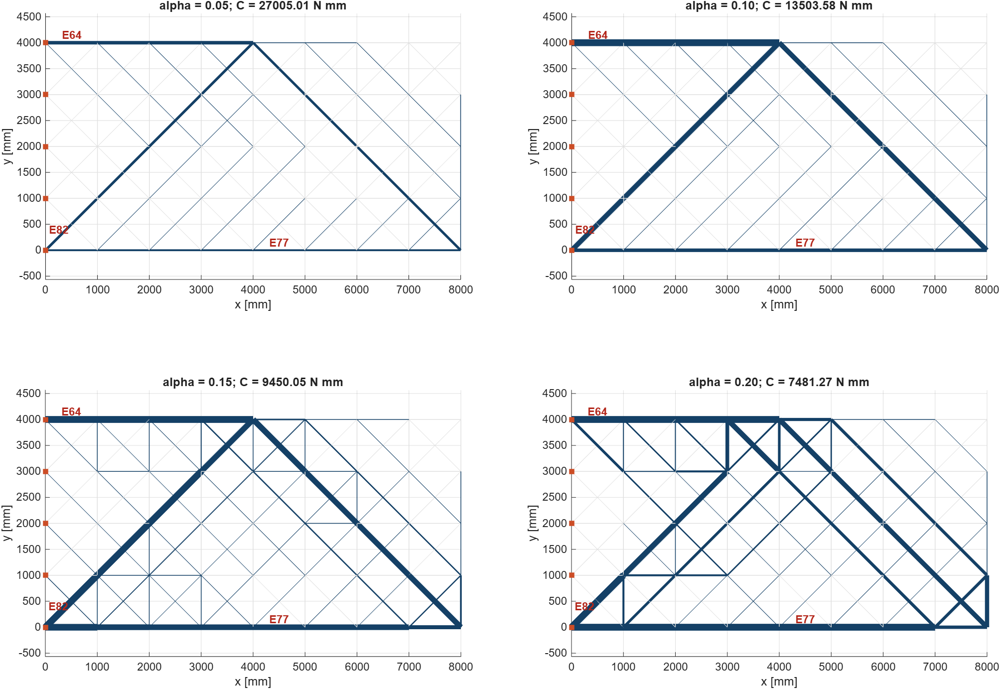

# Truss topology optimization

[Read the numerical report](REPORT.md) · [Finite-element assembly](buildStiffnessMatrix.m) · [Optimization solver](solveConlin.m)



Run either assignment directly from this folder:

```matlab
run_assignment1;
run_assignment2;
```

Each function performs the optimization and leaves its figures open in MATLAB. Nothing is exported or saved. Assignment 1 also displays the requested areas and stresses for elements 64, 77 and 82 in the Command Window.

To keep the numerical results in your workspace:

```matlab
assignment1 = run_assignment1;
assignment2 = run_assignment2;
```

Assignment 1 solves the four prescribed volume fractions. Assignment 2 solves the equal-weight motorcycle problem and the weight sweep, showing compliance, displacement and trade-off plots.

The shared functions implement the course truss FEM, sensitivities and CONLIN dual update. The optimizer retains its convergence criterion and root-solver error checks. There is no separate validation or export workflow.

By default the scalar dual equation uses `fsolve` if available, otherwise base-MATLAB `fzero`. To explicitly select the course template routine:

```matlab
options = struct('dualSolver','fsolve');
assignment1 = run_assignment1(options);
```

This requires Optimization Toolbox. Geometry is read from `data/assignment1` and `data/assignment2`. Units are mm, N, mm^2, mm^3 and MPa; E = 210000 N/mm^2.

Files already in `results` and the earlier report are historical outputs; neither assignment reads or updates them.
